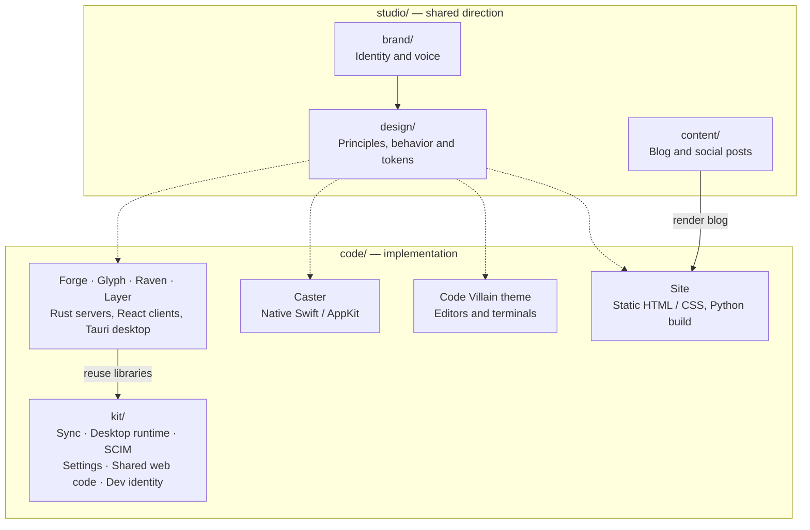
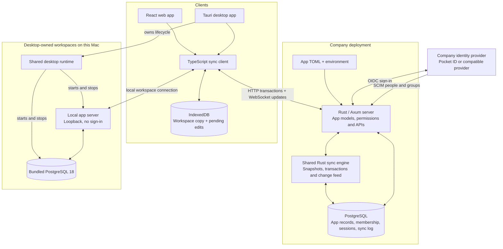

# Code Villain architecture

The vault holds the studio's shared direction and the products that implement it.
Forge, Glyph, Raven and Layer share libraries for sync, identity provisioning,
settings and desktop startup. Each app runs its own server and database.

## Repository

Brand decisions become [design principles and tokens](studio/design/README.md),
which each app implements in its own toolkit. Caster, the theme and the site have
separate builds from the shared server-and-sync platform.

## Application runtime

This pattern repeats per app. Shared kit code is built into each app; each
company deployment has its own server and database. A client's sync connection
targets the server that owns the selected workspace.

Each client keeps a local workspace copy and an outbox of pending edits. The
[sync engine](code/kit/sync/AGENTS.md) applies transactions under the app's rules
and streams authorized changes back to clients. The local app server uses the
same engine; it is condensed into one node above.

[Sync engine architecture](code/kit/sync/architecture.md) follows an edit from
the optimistic local view through server validation and back to every authorized
client, including persistence, confirmation and recovery.

Company sign-in uses OpenID Connect. [SCIM](code/kit/scim/AGENTS.md) provisions
people and groups, which determine workspace membership and roles. Desktop-owned
workspaces start their server and database through the
[desktop runtime](code/kit/desktop/AGENTS.md), without company sign-in.

## Layer's local state

Layer keeps tasks, worktrees, terminals, agent runs and secrets on the Mac. Only
shared setup uses workspace sync. Backend edits pass through a durable file
queue into the sync client; the file queue is acknowledged only after IndexedDB
saves the edits. Stable transaction IDs allow interrupted handoffs to retry.

A Layer profile selects either a company server or its own local server. See
[Layer's architecture](code/apps/layer/docs/architecture.md) for its processes,
storage, integrations and queue handoff.
