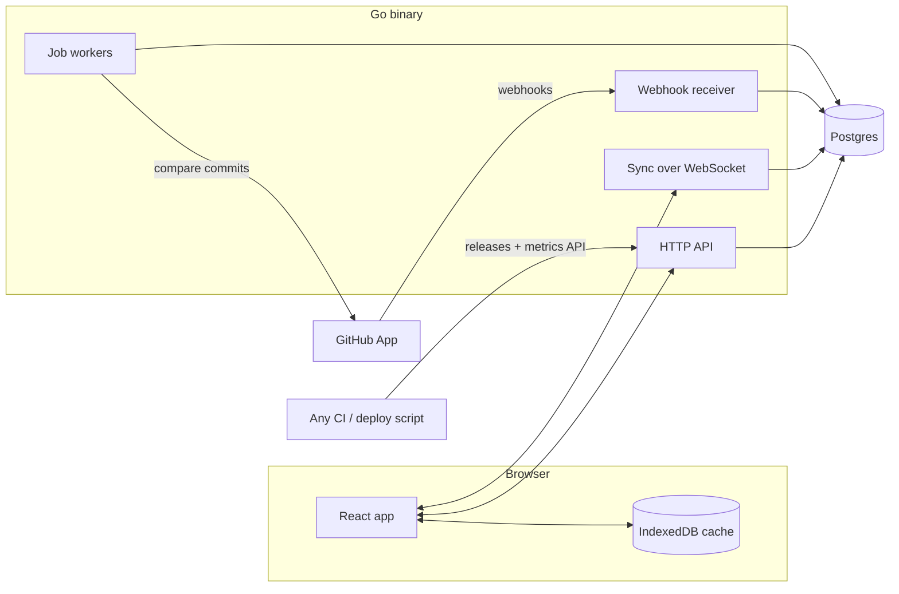

# Architecture

**One Go binary, one Postgres, one React app.** No microservices, no message broker, no Redis in v1. Postgres does the storage, the event log, the job queue, full-text search and change notifications. Add infrastructure only when a measurement says we need it.



In v1 the API, sync, webhook receiver and workers all run in one process (`cmd/schemer`). Workers can be split into their own process later with a flag, because they only talk to Postgres.

## Tech stack

| Layer | Choice | Why |
| --- | --- | --- |
| Language | Go (latest stable) | The learning goal; great for network services |
| HTTP | `net/http` standard library (method + path patterns) | No framework needed; idiomatic |
| Postgres driver | `github.com/jackc/pgx/v5` | The standard |
| Queries | `sqlc`: SQL in `.sql` files, generated typed Go | Real SQL, compile-time safety, no ORM |
| Migrations | `goose` (SQL files in `db/migrations`) | Simple, forward-only in practice |
| WebSocket | `github.com/coder/websocket` | Small, context-aware |
| Logging | `log/slog` (JSON in production) | Standard library |
| Metrics | Prometheus endpoint `/metrics` | Cheap and standard |
| Tests | Go `testing` with table-driven tests; `testcontainers-go` for real Postgres; Playwright for end-to-end | No database mocks |
| Frontend | React, TypeScript (strict), Vite, Tailwind CSS, TanStack Router, Dexie (IndexedDB) | Michael's strengths; a single-page app talking to the Go API |
| CI | GitHub Actions: `go test`, `golangci-lint`, web build, Vitest, Playwright | |
| Deploy | Docker image; target decided in week 3 (see `adr/0006-deploy-target.md`) | |

## Repository layout

```
apps/schemer/
├── CLAUDE.md              # instructions for Claude Code
├── README.md
├── go.mod                 # Go module at the repo root, so go:embed can reach db/
├── docs/                  # vision, scope, architecture, data model, API, ADRs, roadmap
├── db/
│   ├── embed.go           # package db: //go:embed migrations/*.sql (used by the binary and /readyz)
│   ├── migrations/        # goose SQL migrations
│   └── queries/           # sqlc query files, one per domain
├── cmd/schemer/              # main: wires config, db, http, workers
├── internal/
│   ├── config/            # env var parsing
│   ├── store/             # pgx pool, transactions, sqlc output (store/gen)
│   ├── events/            # append, idempotency, notify, replay
│   ├── workitems/         # commands, Apply (projection), queries, search
│   ├── status/            # derived status engine (pure functions + tests)
│   ├── linker/            # PR ↔ work item linking
│   ├── github/            # webhook verify, payload types, processors, API client
│   ├── releases/          # releases, inclusion job, outcomes
│   ├── metrics/           # metric points ingest
│   ├── jobs/              # Postgres job queue + worker pool
│   ├── sync/              # bootstrap snapshot + WebSocket stream
│   ├── auth/              # GitHub OAuth, sessions, invites, API tokens
│   └── httpapi/           # routes, middleware, JSON helpers, errors
├── web/                   # React app (Vite)
│   └── src/
│       ├── sync/          # Dexie store, WebSocket client, optimistic mutations
│       ├── features/      # work-items, releases, search, command-palette
│       └── ui/            # shared components
├── e2e/                   # Playwright tests
├── docker-compose.yml     # Postgres for local dev
└── Makefile
```

Package rule: `internal/<domain>` packages own their commands, projection `Apply` functions and queries. `httpapi` only translates HTTP to domain calls. `status` is **pure** (no database) so it's trivial to test.

## Key flows

### 1. A person changes a work item

```mermaid
sequenceDiagram
  participant UI
  participant API
  participant PG as Postgres
  participant Sync as Sync (other clients)
  UI->>UI: apply optimistically (mutation id m1)
  UI->>API: PATCH /work-items/42 {status: "todo"} + Idempotency-Key: m1
  API->>PG: BEGIN; lock workspace; append event; update projection; NOTIFY; COMMIT
  API-->>UI: 200 {item, seq}
  PG-->>Sync: NOTIFY
  Sync->>PG: read rows changed since cursor
  Sync-->>UI: upsert work_item (seq, mutation id m1)
```

### 2. GitHub sends a webhook

1. `POST /webhooks/github`: verify `X-Hub-Signature-256` (HMAC-SHA256 with the app's webhook secret) in constant time. Reject if it's invalid.
2. Insert into `webhook_deliveries` keyed by `X-GitHub-Delivery`. If it already exists, return 200 and stop. Duplicates do happen (manual redeliveries and our own recovery), even though GitHub never retries automatically.
3. Enqueue job `github.process_delivery` with `dedupe_key = delivery id`, then return 202 immediately. The goal is under 100 ms, well inside GitHub's 10 s timeout.
4. The worker parses the payload, updates `changes` / `check_runs` / `releases` through events, runs the linker, re-evaluates derived status, and sets `processed_at`.
5. Sync pushes the changed rows to every open client.
6. **Recovery:** GitHub doesn't redeliver failed webhooks on its own. A periodic job lists the app's failed deliveries through GitHub's app webhook deliveries API and requests redelivery. After an install, `github.sync_installation` backfills the repos' open PRs.

### 3. Realtime sync (see `adr/0004-sync-strategy.md`)

- **Bootstrap:** `GET /api/w/{ws}/sync/bootstrap` returns every projection row the client needs, plus `cursor` = the latest `seq`.
- **Stream:** a WebSocket at `/api/w/{ws}/sync?cursor=N` first sends everything changed after `N` (catch-up), then streams live changes. Messages are **row upserts**, not raw events, so reducer logic is never duplicated in TypeScript.
- **Fan-out:** every write calls `pg_notify('schemer_events', '<workspace_id>:<seq>')` inside its transaction; Postgres delivers it on commit. One `LISTEN schemer_events` connection per server process wakes the matching WebSocket sessions, which read rows with `last_event_seq > cursor`. Use one channel with the workspace in the payload, because an unquoted channel name can't contain the hyphens in a UUID.
- **Ordering:** writes take a per-workspace advisory lock (see `DATA_MODEL.md`), so within a workspace `seq` order equals commit order and a cursor never skips a row.
- **Members** are plain CRUD, not event-sourced. They come with the bootstrap, and a `members_changed` message tells clients to refetch them.
- **Client:** Dexie holds the rows. The UI reads only from Dexie, so it's instant. Mutations are optimistic with a mutation id; the server echoes it back so the client can confirm or roll back.

### 4. Background jobs (see `adr/0003-postgres-job-queue.md`)

- Workers claim jobs with `SELECT ... FOR UPDATE SKIP LOCKED` and exponential backoff on failure (`run_at = now() + 2^attempts seconds`, capped at 1 hour). After `max_attempts` a job becomes `dead` and shows up in the logs and metrics.
- A reaper resets `running` jobs whose `locked_at` is older than 5 minutes.
- Job kinds in v1: `github.process_delivery`, `github.sync_installation`, `releases.resolve_contents`, `releases.compute_outcome`.

## Security basics

- GitHub webhook signatures are always verified. Never trust a payload before that.
- Session cookie: `HttpOnly`, `Secure`, `SameSite=Lax`; store only the SHA-256 of the token.
- API tokens: shown once, stored hashed, scoped to one workspace.
- Every query is scoped by `workspace_id`, and the HTTP layer checks membership. Tests cover cross-workspace access.
- The GitHub App requests the smallest permissions that work: pull requests (read), checks (read), deployments (read), contents (read, for the compare API), metadata (read).

## Observability

- `slog` JSON logs with `request_id`, `workspace_id`, `job_id` fields.
- Prometheus metrics: HTTP latency histograms per route, job duration and failures per kind, webhook-to-event latency, WebSocket connection count.
- Health: `/healthz` (process up) and `/readyz` (database reachable, migrations current).
- One alert to start with: "dead jobs > 0" or "webhook-to-event p95 > 5 s", plus an external uptime check.
