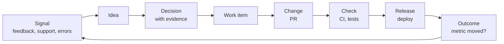

# Vision

> **Schemer** is a Code Villain product, alongside Layer and Caster.

## The problem

Code has become cheap. With AI coding tools, a small team can ship more code in a week than it used to ship in a month. Everything *around* the code hasn't kept up:

- **Tickets go stale.** Someone has to drag every card from "In progress" to "Done", and nobody does.
- **Docs go stale.** The code changes; the doc that describes it doesn't.
- **Tests slow everyone down.** Slow and flaky suites are known pain that nobody tracks.
- **Decisions have no evidence.** Asked "why did we build this, and did it work?", most teams shrug. The customer feedback, the decision, the code, the release and the result all live in different tools.

Tools like Jira come from an era when writing the code was the slow part. They are systems of record that humans feed by hand. When code is cheap, feeding the tools by hand is the bottleneck.

## The thesis

**A product delivery tool that feeds itself.** It keeps itself current from the repo, CI, deploys and product data, and shows where the code has run ahead of everything else.

## The loop

The long-term product covers the whole loop from idea to customer impact, with evidence attached at every step:

| Stage | What it holds | How it gets there |
| --- | --- | --- |
| Signal | Customer feedback, support tickets, usage data, errors | Connectors (support, analytics, error tracking); manual entry |
| Idea | A proposed change to the product | Created from one or more signals |
| Decision | Why we're doing it, the evidence, the expected outcome | Written by a person; evidence links to signals and metrics |
| Work item | The unit of delivery (what Jira calls a ticket) | Created from a decision, or directly |
| Change | A pull request | GitHub, linked automatically |
| Check | CI runs and tests | GitHub checks, automatically |
| Release | A deploy to an environment | GitHub deployments or the release API |
| Outcome | Did the expected metric move? | Metrics API, computed automatically before vs. after release |

Every stage is a **node** in one graph, every link between stages is an **edge**, and every change is an **event** with a timestamp. "Show me the evidence for this decision" and "did this release move activation?" become queries.

## Customer

**Small product teams (5–30 people) that ship fast with AI coding tools.** They feel the "code is cheap, the rest can't keep up" pain most, and they don't have a PM layer papering over it. Typical buyer: the tech lead or founding engineer.

## What makes it different

1. **It feeds itself.** Status comes from what actually happened (PR opened, CI green, merged, deployed), not from someone dragging a card.
2. **It connects code to customer impact.** Work items know which release shipped them, and releases know which metric they were meant to move.
3. **It's instant.** Keyboard-first, updates in real time, no page loads. The opposite of Jira.

## Product principles

- **Derived first, manual second.** If the system can know it, nobody should have to type it.
- **Evidence over opinion.** Decisions link to data; outcomes are checked automatically.
- **Instant or it doesn't ship.** Every interaction feels immediate (see performance budgets in `V1_SCOPE.md`).
- **One graph.** New stages are new node types and connectors, never a rewrite.
- **Calm UI.** Few fields, no required forms, keyboard for everything.

## Roadmap stages

| Stage | Scope | Status |
| --- | --- | --- |
| **v1: the delivery slice** | Work item → Change → Check → Release, derived status, realtime UI, one release-metric hook | Now (see `V1_SCOPE.md`) |
| v2: staleness | Docs and tickets flagged when the code they reference changes; slow and flaky test tracking | Next |
| v3: decisions | Ideas and decisions with evidence; expected outcome checked after release | Later |
| v4: signals | Connectors for support, analytics and error tracking; signals linked to ideas | Later |
| v5: teams | Multiple workspaces, roles and permissions, billing, Jira importer | Later |

## Non-goals (for now)

- Replacing product analytics. We read metrics; we don't collect them.
- Enterprise features (SSO, audit exports, custom workflows).
- AI features for their own sake. AI is welcome where it removes manual work (for example drafting a stale doc's update), never as a gimmick.

## Open decisions

- Visual identity for Schemer within the Code Villain Doom-core direction (Michael's call).
- Open source or closed? (For example an AGPL core with hosted SaaS, or fully closed.)
- Pricing model.
- Hosting target for the public beta (see `adr/0006-deploy-target.md`).
