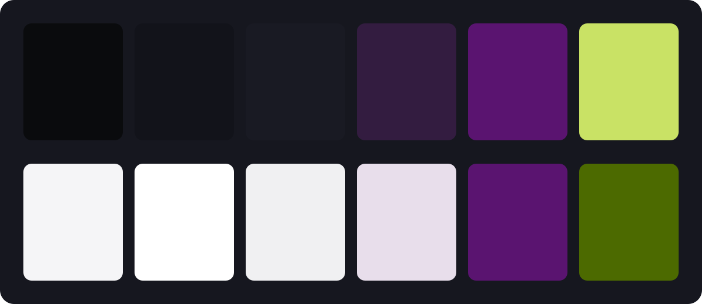
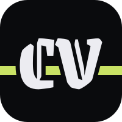

Code Villain had three products and no look. Forge was indigo, Layer was lavender, the homepage was a test font matched off a generated picture. Today that ended. The whole studio now draws from one place: `brand/` and `design/` in the vault.

## Type

Four pairings went up against the test font. Code Villain picked the boldest: Grenze Gotisch, a gothic display face, for the big titles, and Atkinson Hyperlegible Next for everything read or clicked. The gothic is the costume. Atkinson is the person inside it. Grenze never goes below 28px and never sets a paragraph.

## Colour

Nightshade stays: night `#0B0B0B`, poison chartreuse, cloak violet. Grey does the work now. On the second day the two colours swapped places. The chartreuse was in every mark and every live dot; it was the colour anyone remembered. So poison is the brand: the strike, the main action, small live dots like "agent running". Cloak supports it with depth, and a lifted violet marks focus. Links are ink, bold, underlined.

There is a day mode too, for the apps. Poison is light, so it stays a fill by day: the button keeps its chartreuse and takes dark ink, at 12.3:1. The swap itself was two lines in `color.json`; the generator worked out the rest.



Every surface reads the same names. An app switches to day with one attribute:

```css
/* design/tokens/color.css, generated from color.json */
[data-theme="day"] {
  --bg: #F5F5F5;
  --panel: #FFFFFF;
  --primary: #C9E265;
  --accent: #5A1470;
}
```

## The button

Five directions, one shape: 28px, 13px semibold, no border. It ended chartreuse with dark ink, once per screen. In an issue, the title reads first, then the text, then the button. As it should.

## The mark

Four concepts: a strike, an iron mask, a seal, a hood. The strike won. Twenty-five variants later, the bar sits low and heavy behind the letters, cut where they cross. It began as a gothic V. The V said Villain and nothing about Code, so the C joined it: CV, one unit apart, so their two cuts meet and the bar stops between them. Forge, Layer and Caster wear their initials the same way: F, L, C.



The cut is one mask. The letters, drawn again with a thick stroke, punch a gap in the bar wherever they cross:

```svg
<mask id="cut">
  <rect width="200" height="200" fill="#fff"/>
  <use href="#cv" stroke="#000" stroke-width="14"/>
</mask>
<rect y="108" width="200" height="15" fill="#C9E265" mask="url(#cut)"/>
```

## What it cost

Two days, a dozen studies, one colour swap, and a rule written down for every decision, so the apps can catch up without asking. The rest is in the record.
